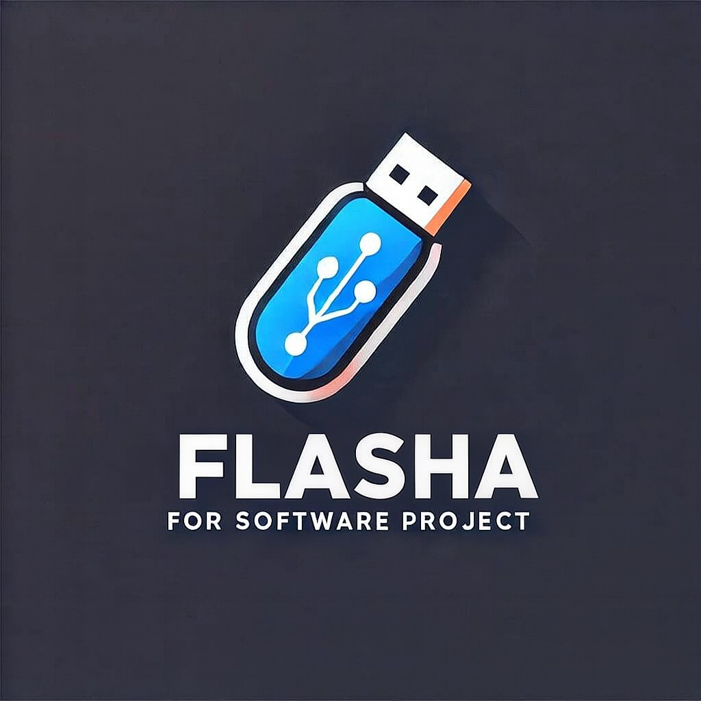

<div align="center">

<!-- FLASHA Logo -->


<br/><br/>

<!-- Animated Header (twinkling) -->


<!-- Typing Animation -->
<a href="https://github.com/DevEmad2001">
  
</a>

<br/><br/>

<!-- Intro Badges -->


<p align="center">
  <em>Building backend systems, business platforms, digital products, and practical technical solutions.</em>
</p>

<br/>

<!-- Social -->
<a href="https://github.com/DevEmad2001"></a>
<a href="https://www.linkedin.com/in/emad-atieh/"></a>
<a href="https://www.instagram.com/dev.e.atieh"></a>
<a href="https://www.facebook.com/share/1DuNsoxiMu/?mibextid=wwXIfr"></a>

<br/><br/>

<!-- Divider -->


</div>

<!-- ===================== ABOUT ME ===================== -->

<div align="center">


</div>

<table>
<tr>
<td width="55%">

```csharp
public class EmadAtieh : Developer
{
    public string Role     => "Founder & CEO @ FLASHA";
    public string Location => "Amman, Jordan 🇯🇴";

    public string[] Stack => new[]
    {
        ".NET", "C#", "Sitecore", "SQL Server",
        "Python", "React", "Flutter"
    };

    public string[] Focus => new[]
    {
        "Backend Engineering",
        "Platform Building",
        "AI & Data Science Training"
    };

    public string Motto =>
        "Code. Build. Solve.";
}
```

</td>
<td width="45%" align="center">


<br/><br/>


</td>
</tr>
</table>

<!-- ===================== WHAT I DO ===================== -->

<div align="center">


<br/><br/>

<h2>✨ Turning Ideas Into Real Products</h2>

<p align="center">
  I build systems, platforms, and digital products that solve real business problems.<br/>
  My work combines backend engineering, software architecture, product thinking, and practical AI solutions.
</p>

<br/>


<br/><br/>

<h2>🚀 My Core Zones</h2>

<table align="center">
  <tr>
    <td align="center" width="33%">
      <br/><br/>
      <strong>⚙️ Backend Engineering</strong><br/><br/>
      APIs, business logic, database design,<br/>
      clean architecture, and maintainable systems.
    </td>
    <td align="center" width="33%">
      <br/><br/>
      <strong>🧩 Platform Building</strong><br/><br/>
      Admin systems, dashboards, internal tools,<br/>
      and products built for real workflows.
    </td>
    <td align="center" width="33%">
      <br/><br/>
      <strong>🤖 AI & Training</strong><br/><br/>
      Practical AI use cases, automation ideas,<br/>
      and technical learning experiences.
    </td>
  </tr>
</table>

</div>

<!-- ===================== TECH STACK ===================== -->

<div align="center">


<h3>💻 Languages & Frameworks</h3>


<h3>🗄️ Databases & Tools</h3>


<br/><br/>


</div>

<!-- ===================== GITHUB STATS ===================== -->

<div align="center">


<br/>


<br/><br/>


<br/><br/>


<br/><br/>

<!-- Snake animation (needs .github/workflows/snake.yml) -->
<picture>
  <source media="(prefers-color-scheme: dark)" srcset="https://raw.githubusercontent.com/DevEmad2001/DevEmad2001/output/github-contribution-grid-snake-dark.svg" />
  <source media="(prefers-color-scheme: light)" srcset="https://raw.githubusercontent.com/DevEmad2001/DevEmad2001/output/github-contribution-grid-snake.svg" />
  
</picture>

</div>

<!-- ===================== CURRENT FOCUS ===================== -->

<div align="center">


<h2>🛠️ Currently Focused On</h2>


<br/><br/>

<h2>🌟 Work Style</h2>


<br/><br/>

<details>
<summary><b>⚡ Click for some fun facts</b></summary>
<br/>

- 🏢 Founder & CEO of **FLASHA**
- 🧠 I train people in **AI & Data Science**
- ☕ Powered by coffee and clean code
- 🎯 I care about software that creates **real business value**

</details>

<br/>


</div>

<!-- ===================== CLOSING ===================== -->

<div align="center">


<h2>💡 Final Note</h2>

<p align="center">
  I enjoy building software that solves real problems, supports real people, and creates real value.<br/>
  From backend systems to digital products and practical AI solutions,
  I focus on clarity, scalability, and meaningful execution.
</p>


<h2>🤝 Let's Connect</h2>

<a href="https://github.com/DevEmad2001"></a>
<a href="https://www.linkedin.com/in/emad-atieh/"></a>
<a href="https://www.instagram.com/dev.e.atieh"></a>
<a href="https://www.facebook.com/share/1DuNsoxiMu/?mibextid=wwXIfr"></a>

<br/><br/>


<br/><br/>


<br/><br/>

<p align="center">
  <strong>Emad Atieh</strong> — Founder, Builder, and Engineer of practical digital solutions.
</p>


</div>
